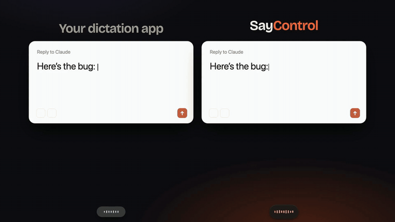
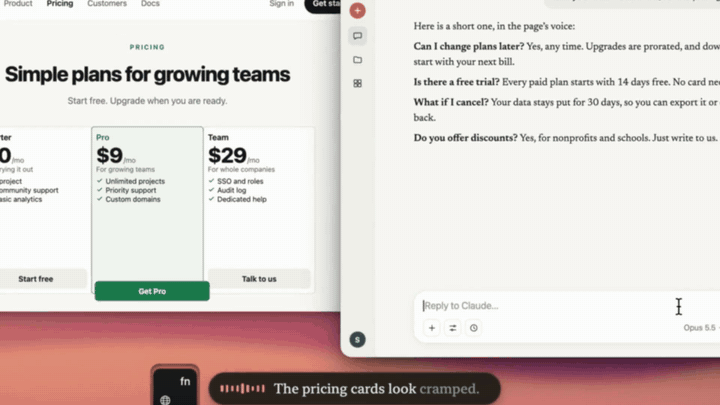
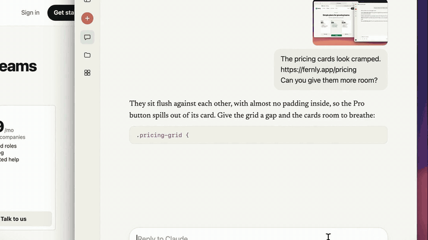
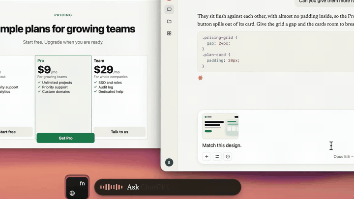
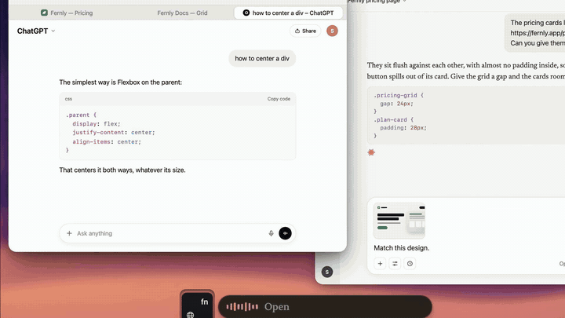

<div align="center">


# SayControl

**An open-source Mac app that types what you say, and does what you ask.**<br>
Take a screenshot, paste a link, attach a file, open an app or a terminal, ask ChatGPT, send the message. By voice, in any app.

<a href="https://cdn.sayctrl.com/SayControl.dmg"></a>

[](LICENSE)


[🌐 Website](https://saycontrol.com) · [▶️ Demo video](https://cdn.sayctrl.com/film/saycontrol-demo.mp4) · [🗣️ Every spoken control](https://saycontrol.com/controls) · [🛠️ Build from source](#%EF%B8%8F-build-from-source)

<br>

<a href="https://cdn.sayctrl.com/film/saycontrol-demo.mp4"></a>

<sub>▶️ <a href="https://cdn.sayctrl.com/film/saycontrol-demo.mp4"><b>Watch the full 50-second demo</b></a> (with sound)</sub>

</div>

---

## ✨ More than dictation

Most dictation apps type whatever you say. Say "take a screenshot" and you get the words. SayControl takes the screenshot.

Hold **fn**, talk, let go. Your words land wherever the cursor is, and these phrases do the thing instead:

| 🗣️ Say | ⚡ What happens |
|---|---|
| "take a screenshot" | A picture of your screen, pasted mid-sentence |
| "copy the link" | The address of the browser tab in front of you |
| "attach the PDF from downloads" | The newest match, attached for real. Several matches float a picker: say "the first one" |
| "copy the file path" | Whatever Finder has selected, as a full path |
| "open Chrome" | Apps and sites, by name |
| "open terminal in the downloads folder" | A terminal, already standing in that folder |
| "ask ChatGPT how to center a div" | The question opens in ChatGPT, already asked. Claude, Grok, Perplexity and Google too |
| "scratch that" | Takes back the last paste |
| "send it" | Presses Return for you |
| "add everything and commit saying ship the fix" *(in a terminal)* | `git add . && git commit -m "ship the fix"`, waiting at the prompt until you press Return |
| Hold **fn + control**: "make it shorter" | Command mode rewrites what you selected, or the whole box |

<table>
  <tr>
    <td width="50%"><br><b>📸 Screenshot and link, straight into Claude</b></td>
    <td width="50%"><br><b>📎 Attach a file by saying its name</b></td>
  </tr>
  <tr>
    <td width="50%"><br><b>💬 Ask ChatGPT without leaving your sentence</b></td>
    <td width="50%"><br><b>↩️ Changed your mind? "Scratch that"</b></td>
  </tr>
</table>

Nothing runs behind your back: a terminal command waits at the prompt for your Return, and the ones you can't undo (`rm`, `sudo`, `--force`) won't take a spoken "send it". The full list, with every phrasing, is at **[saycontrol.com/controls](https://saycontrol.com/controls)**.

## 🎙️ The dictation itself

- 🧹 **Cleans up as it goes.** Ums, stutters and false starts are gone before the text lands.
- 🎨 **Writes in the right register.** Tones pick casual through formal for Personal, Work, Email and Agents, by the app you're in. Your words stay yours: a tone only changes punctuation, casing and layout.
- 🧠 **Learns your words.** Fix a word right after it lands and it's spelled right next time.
- 👀 **Reads the room.** Names and jargon on screen are handed to the recognizer, so they come out right the first time.
- ⚡ **Phrases.** Say "my email address" and the whole address is typed.
- 🌍 **60+ languages.**

## 🤖 Talk to your coding agents

Claude Code and Codex tell you out loud when they finish or need a yes ("Your agent on fernly wants to run: npm test. Say allow or deny."), and you answer by voice. This runs on SayControl Cloud: 10 conversations to try on Free, 300 a month on Pro.

## 🧭 Three ways to run it

Pick in **Settings › Models**. Every route needs a free SayControl account.

| | ☁️ SayControl Cloud | 💻 This Mac | 🔑 Your own API key |
|---|---|---|---|
| **Speech to text** | The most accurate live models we've measured, picked for you | Cohere Transcribe, Qwen3-ASR, Parakeet, Nemotron, Voxtral, Whisper | OpenAI, ElevenLabs, AssemblyAI, Soniox, xAI, Google, OpenRouter… |
| **Cleanup and tones** | Included | On your own key: Claude, OpenAI, OpenRouter, Cerebras, Groq, Google | On your own key |
| **Spoken controls & Ask** | Pro | ✅ Free | ✅ Free |
| **Command mode** | Pro | ✅ Free, on your own key | ✅ Free, on your own key |
| **Price** | Free: 2,000 words a week · Pro: $12/month, unlimited | Free | Free (your provider bills you) |
| **Internet** | Needed | Not needed for speech | Needed |

Most local models write while you talk. Which ones keep up live is measured on your own Mac the first time each loads.

## 📥 Install

1. **[Download the DMG](https://cdn.sayctrl.com/SayControl.dmg)** and drag SayControl to Applications. It's signed and notarized.
2. Open it, sign in, and allow the **Microphone**, **Accessibility** and **Input Monitoring** when the setup asks.
3. In System Settings › Keyboard, set "Press 🌐 key to" to **Do Nothing**.
4. Hold **fn** and talk.

Needs macOS 13 or later, on Apple silicon or Intel. Updates install themselves.

## 🛠️ Build from source

```bash
git clone https://github.com/soorower/SayControl.git
cd SayControl
SAYCTRL_DEV=1 ./scripts/build.sh    # "SayCtrl Dev.app": every provider, plus the dev tools
./scripts/build.sh                  # SayControl.app: the build people download
```

You need macOS 13+, the Xcode command line tools and cmake. The first build fetches [whisper.cpp](https://github.com/ggml-org/whisper.cpp), [CrispASR](https://github.com/CrispStrobe/CrispASR) and [Sparkle](https://sparkle-project.org) at pinned versions and compiles the speech engines into the app (a few minutes, once). Without an Apple certificate the build is signed ad-hoc: it runs, but macOS asks for permissions again after every rebuild.

The two builds are separate apps to macOS, with their own settings (`~/.config/sayctrl` and `~/.config/sayctrl-dev`), so they can sit side by side.

## 🗂️ Find your way around

| Area | Where |
|---|---|
| 🚦 The app: key down → record → transcribe → clean up → paste | [`Sources/main.swift`](Sources/main.swift) |
| 🗣️ Spoken controls | [`Commands.swift`](Sources/Commands.swift) (the grammar), [`AttachFiles.swift`](Sources/AttachFiles.swift), [`FinderPaths.swift`](Sources/FinderPaths.swift), [`OpenTarget.swift`](Sources/OpenTarget.swift), [`TerminalTarget.swift`](Sources/TerminalTarget.swift) |
| 💻 Terminal commands | [`Shell.swift`](Sources/Shell.swift): every command it can write, readable in one file |
| ✍️ Command mode | [`CommandMode.swift`](Sources/CommandMode.swift) |
| 🎧 Speech, streaming | [`LiveTranscribe.swift`](Sources/LiveTranscribe.swift) (cloud and API-key providers over WebSocket) |
| 💻 Speech, on this Mac | [`LocalEngine.swift`](Sources/LocalEngine.swift), [`LocalLive.swift`](Sources/LocalLive.swift), [`LocalSpeed.swift`](Sources/LocalSpeed.swift), [`scripts/engines/`](scripts/engines) (C++ around CrispASR) |
| 🧹 Cleanup and tones | [`Refine.swift`](Sources/Refine.swift), [`Tones.swift`](Sources/Tones.swift), [`ModelKeys.swift`](Sources/ModelKeys.swift) |
| 🧠 Learning your words | [`Corrections.swift`](Sources/Corrections.swift), [`Replacements.swift`](Sources/Replacements.swift), [`Phrases.swift`](Sources/Phrases.swift), [`ScreenVocab.swift`](Sources/ScreenVocab.swift), [`Hints.swift`](Sources/Hints.swift) |
| 🤖 Coding agents | [`AgentBridge.swift`](Sources/AgentBridge.swift), [`CodexBridge.swift`](Sources/CodexBridge.swift), [`ClaudeWatcher.swift`](Sources/ClaudeWatcher.swift), [`VoiceIO.swift`](Sources/VoiceIO.swift) |
| ☁️ Account and cloud | [`Cloud.swift`](Sources/Cloud.swift), [`Account.swift`](Sources/Account.swift), [`SignIn.swift`](Sources/SignIn.swift) |
| 🪟 Windows and settings | [`SettingsUI.swift`](Sources/SettingsUI.swift), [`SettingsPane.swift`](Sources/SettingsPane.swift), [`ModelsPage.swift`](Sources/ModelsPage.swift), [`Components.swift`](Sources/Components.swift), [`Theme.swift`](Sources/Theme.swift) |
| ⚙️ Settings on disk | [`Config.swift`](Sources/Config.swift): `~/.config/sayctrl/.env` |
| 🎨 Design mock-ups | [`design/`](design): the HTML each screen was built from |
| 📦 Build and release | [`scripts/`](scripts): `build.sh`, `make_dmg.sh`, `release.sh` |

Handy dev flags on the built binary: `--transcribe <file.wav>` runs a clip through the current model, `--snapshot <dir>` draws every settings pane to PNG, `--modelsshot <dir>` draws Settings › Models in each state.

## 🔒 Privacy

Your history, recordings, dictionary and phrases stay on your Mac. On a local model your voice never leaves it; on your own key it goes only to that provider. On SayControl Cloud your audio passes through our servers to be written down and isn't kept there. Details: [saycontrol.com/privacy](https://saycontrol.com/privacy).

## 🙌 Credits

- [whisper.cpp](https://github.com/ggml-org/whisper.cpp) and ggml (MIT) run Whisper and Parakeet.
- [CrispASR](https://github.com/CrispStrobe/CrispASR) (MIT) runs Cohere Transcribe, Qwen3-ASR, Voxtral and Nemotron. `scripts/engines/qwen3_run.cpp` and `voxtral4b_run.cpp` are adapted from its command-line examples, and `nemotron_stream.cpp` builds on its Nemotron backend. Both projects are Copyright (c) 2023-2026 The ggml authors.
- [Sparkle](https://sparkle-project.org) (MIT) installs updates.
- [Bricolage Grotesque](https://github.com/ateliertriay/bricolage) is under the SIL Open Font License ([`Resources/Fonts/OFL.txt`](Resources/Fonts/OFL.txt)).
- The models are their makers' work under their own licences: Cohere Transcribe, Qwen3-ASR and Voxtral (Apache 2.0), Parakeet (NVIDIA, CC BY 4.0), Nemotron (NVIDIA, OpenMDW 1.1), Whisper (OpenAI, MIT).

## 📄 Licence

[MIT](LICENSE): use it, change it, ship it. The licence covers the code, not the SayControl name or icon, so a copy you ship should go by its own name. Found a security problem? See [SECURITY.md](SECURITY.md).
